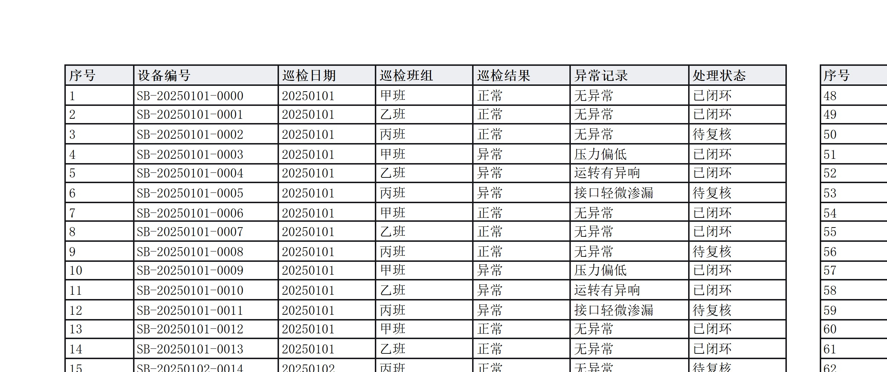

# 分栏打印

把一张几千行的长表格，按 A4 分栏重排后打印。**一个 HTML 文件，双击就能用，不上传任何数据。**

很多「长清单」类表格（流水号、保单、台账、巡检记录）列不多但行数极多，原样打印动辄一两百页。这个工具把它们按报纸流向排成两栏、三栏，页数通常能砍掉一半，并且保证：

- **序号连续**：左栏读到底接着读右栏，翻页再续，一行都不会丢或错位
- **每栏都有表头**：散页之后单拿一栏起来也知道是什么
- **公文页码**：页脚居中「第 X 页 共 Y 页」，总页数排版时就算好
- **内容不动**：只读取单元格的显示文本，不重排、不改格式、不四舍五入，空单元格留空


## 用法

1. 双击 `index.html`（Chrome / Edge / 各家国产浏览器都可以）
2. 把 `.xlsx` / `.xls` / `.csv` 拖进页面
3. 看顶上三个数字：行数 / 页数 / 双面张数
4. 不合适就调：方向、栏数、字号、行距、栏间距、页边距；列宽还能直接拖表头边线
5. 点「打印」

**打印对话框里**：边距选「无」，缩放保持 100%，取消勾选「页眉和页脚」。纸张选 A4，方向和面板一致。

只想先试样，在「页码范围」里填 `1-10`。



## 导出 Excel，在本地 Excel/WPS 里打印

不想在浏览器里打印的话，点「导出 Excel」：生成一个 `.xlsx`，里面有两个工作表——

- **打印版**：网页排好的版式原样冻结进去（列宽、行高、每栏表头、边框、灰底），每一页之间是 Excel 手动分页符，页面设置（A4、方向、页边距）已写好。打开后直接 `Ctrl+P`，打出来的页数、页码和网页预览**完全一致**——页脚用的是 Excel 原生「第 &P 页 共 N 页」，即使你在 Excel 里删了几行，页码也不会错
- **数据**：原始平表，带筛选和冻结首行，留着改数、筛选、导给别的系统用

「页码范围」对导出同样生效：填 `3-10`，打印版只含那 8 页，且页码从「第 3 页」开始计，总页数仍按整表算。

注意：打印版里的内容是**排版结果**，在 Excel 里改动单元格不会重排（数据表里改）。

## 打印是怎么走的

点「打印」不会在当前页面里堆几千个 DOM 节点，而是**另开一个只含纸张的窗口**，在那边调起打印，打完自动关闭。好处是主界面全程不卡，打印对话框也打开得快。第一次会问是否允许弹窗，允许一次即可；万一被拦，会自动回退到当前页打印，也可以直接按 `Ctrl+P`。

## 打印设置与页脚说明

- 打印版工作表的页脚是 Excel 原生页脚（宋体、居中、随打印自动编号），不是写在单元格里的静态文本
- 整份文件按 Chrome 83 内核的浏览器生成；生成的 xlsx 在 Microsoft Excel 与 WPS 上验证过分页与页脚
- 单元格里的数字以文本存储（保留前导零），Excel 屏显可能标绿色小三角，不影响打印

## 兼容性

- **Chrome 83 起步**：不用 flex `gap`、`overflow: clip`、容器查询、`:focus-visible` 等新特性，脚本是 ES5
- 麒麟 / 统信 / 奇安信这类内网浏览器可直接跑
- **完全离线**：没有任何网络请求，断网、拔网线一样用

## 从源码构建

```bash
node build.mjs     # 产出 index.html
```

`build.mjs` 会把 `src/app.css`、`src/app.js` 和 SheetJS 一起内联成单文件。SheetJS 不放在仓库里，首次构建时自动下载（约 950 KB）。

开发时可以直接打开 `src/index.html`，它引用的是外链的 css/js，改完刷新即可。

## 实现上几个关键点

**几何全部用毫米推导。** 纸张宽高、页边距、栏间距、行高都是 mm，预览和打印共用同一组数值，所以「预览什么样，打出来就是什么样」是结构保证，不是靠目测调的。

**预览是虚拟化的。** 8000 行会排出八十多页，全塞进 DOM 要命（信创机器上直接卡死）。现在只渲染可见的那几页，滚动时按需替换，一张几十万单元格的表，滚动响应在 5 毫秒量级。

**表格线画在单元格上，不用间隙透色。** 用 grid 的 `gap` 让底色透出来当线，在缩放和累积取整下会在某一行塌成 0 像素，表现就是「每页同一个位置少一条横线」。改成每个单元格自己画右边框和下边框后，线不可能消失。

**字宽用真实排版实测。** canvas 的 `measureText` 在小字号下比真实排版窄约 6%（浏览器会把字形步进取整到 1/64 像素），拿它算列宽会把文字切掉。现在用 DOM 实测单字宽度再求和。

**分页是纯数学。** 先算出每行高度，再把行装进栏、栏装进页，行是排版的最小单位，永远不跨栏断开。

## 已知边界

- 只读**第一个工作表的表头行**；多工作表会列出来让你选
- 不做合并单元格拆解、公式重算、多表合并打印
- 预览在「适应宽度」下整页被缩到 50～70%，0.26mm 的表格线在屏幕上只剩半个像素，看着会偏淡；点「100%」或打印出来就是准确的
- 中文默认宋体，可切黑体；机器上没有宋体时浏览器会用系统衬线代替（预览和打印始终一致）

## 第三方

表格解析用 [SheetJS](https://sheetjs.com)（Apache-2.0），构建时内联进单文件。
